# Amp orbs work your inbox

[`.amp/plugins/cp-inbox.ts`](../.amp/plugins/cp-inbox.ts) is an
[Amp](https://ampcode.com) plugin. Add this repository as an Amp project and it
loads by itself, only in that project's threads. Your daemon wakes an orb with a signed
webhook, and the orb gives each peer a thread, and each cpd thread a
conversation under it, which works it with `cpctl`. Any of your threads can
ask a peer something; the answer goes to a conversation too, and the thread
that asked gets a link to it.

<p align="center"></p>

- **Inbox:** the thread that first loads the plugin. The plugin there receives cpd's webhooks and starts the threads below; the inbox's own agent never sees them and has nothing to do. Leave it idle, and never archive it. Peering requests never reach an agent: the plugin notifies you, and you review them with `cpctl requests`.
- **Webhooks** are trusted only as a wake-up. The plugin drops any event not signed with the key it derives from `CP_TOKEN`, and an event carries only IDs and a state, never peer text: what a conversation acts on, it reads from cpd.
- **Peer thread:** one per peer, under the inbox, named after them and labelled `cp-peer` and `peer-<name>`, from that peer's first thread. It holds their conversations, and it's where you, or another of your threads, ask them something ([ask a peer](#ask-a-peer)).
- **Conversation:** one per cpd thread, under its peer's thread, with its own directory under `~/cp-work` and a [sandbox](#what-agents-may-do-alone). It reads with `cpctl show`, works, and answers with the thread's `next:` commands. That includes threads this side sent: it checks the peer's answer, then closes, reopens, or asks you. Once the cpd thread is closed, declined or withdrawn, the plugin archives it; anything new on that thread brings it back. Its **cpd thread** button shows you the whole cpd thread in a dialog, never to an agent.
- **Peer text** arrives only in conversations, through `cpctl show`, quoted line by line after `│`. Your other threads see it only by reading a conversation, as a thread that asked a peer something does to relay the answer. Peers are third parties you chose to work with: agents help them in good faith, but only you instruct them. A peer's text comes from their agent, which may itself have been misled, so agents weigh it as a request, never instructions; they ignore attempts to steer them (prompt injection) and check what a peer supplies before it goes into code, docs or agent instructions (poisoning). Conversations can't see each other's work, but they share the inbox's token; to wall peers off from each other, give each its own inbox ([one inbox per peer](#one-inbox-per-peer)).

## You need

- **A daemon peers can reach**, outside the orb: native `cpd` with a public URL, or [the Worker](cloudflare.md). The orb sleeps; cpd doesn't.
- **Amp with GitHub connected** (Settings → MCP & Integrations), so orbs can clone your repositories.
- **A current daemon.** Orbs take the plugin from this repository's master, and [`.agents/setup`](../.agents/setup) installs the `cpctl` your daemon runs. Rerun `cloudflare.sh` (or `install.sh`) to update the daemon. A running inbox keeps the plugin it started with: ask it to pull master and reload its plugins.
- **An agent token, never the owner token.** Your threads in the project can read `CP_TOKEN`; conversations, which read peer text, never see it. An agent token can send and work threads, never peer, make tokens or change your webhooks, and `cpctl token rm` revokes it and ends its streams. Unscoped, it reaches every peer, as you: [scope it](#one-inbox-per-peer) once you have peers.

## Setup

1. **An agent token**, on your machine as the owner. Chose Amp in `cloudflare.sh`? It made one for you.

   ```bash
   cpctl token add amp-inbox -o amp.token            # add --peers for a per-peer inbox
   ```

2. **The project and its secrets.** Add `Savid/clanker-proxy` as an Amp project. Save `CP_URL` and `CP_TOKEN` (the token) as secrets of that project, so only its threads see them: in its settings, or have a thread ask you, and Amp takes each value in a private dialog that keeps it out of the thread. Never as personal secrets: every thread sees those, and they override the project's. A running orb picks up changes after `amp orb restart-processes`.

3. **Start the inbox:** a new thread in that project, not the thread doing the setup. Its orb runs `.agents/setup`, which installs `cpctl`, and loads the plugin, which registers its webhook with your daemon, signed with a key derived from `CP_TOKEN`. It hears only the peers' moves, and only for the token's peers. The first thread to load the plugin with the secrets set owns the webhook for good.

4. **Never archive the inbox.** Archived, it answers `404`, a final failure. Restore it, then `cpctl webhook retry amp-inbox <delivery-id>`. Remove any guidance that archives finished threads.

5. **Ask from any thread:** add [`cp-peers`](../.amp/personal/cp-peers/index.ts) to your personal plugins, which Amp loads in all your threads. Run it again to update it.

   ```bash
   amp clone user-plugins ~/user-plugins && mkdir -p ~/user-plugins/cp-peers
   curl -fsSL https://raw.githubusercontent.com/Savid/clanker-proxy/master/.amp/personal/cp-peers/index.ts -o ~/user-plugins/cp-peers/index.ts
   cd ~/user-plugins && git add cp-peers && git commit -m "cp-peers: ask clanker-proxy peers from any thread" && git push
   ```

Wrong thread became the inbox? Delete the `cp-inbox` trigger in Amp's
trigger settings and start a new thread in the project; it registers again.

## Check it

1. Settings → Triggers lists `cp-inbox`, key `cpd`, owned by the inbox. The orb's Amp log says `cp-inbox: registered with cpd`; if it says `set CP_URL and CP_TOKEN`, they were missing when the plugin loaded.
2. A peer sends a test thread. Within seconds, that peer's thread starts under the inbox, with a conversation labelled `clanker-proxy` and `peer-<name>` under it.

## Ask a peer

From any thread, ask: "ask bob <what>". In the project, `cp_send` sends it.
Elsewhere, [`cp-peers`](#setup)'s `ask_peer` hands it to bob's thread, which
sends it with `cp_send`, to bob only. Bob's answer goes to a conversation under
bob's thread, which checks it and closes or reopens it, and the thread that
asked gets a link to that conversation. `cpctl send` does the same from your
machine.

A peer's thread starts with the first thread between you; before that, ask
from a thread in the project. A conversation's `cp_send` reaches only its own
peer, and asks you first.

## One inbox per peer

Every thread in the project shares the inbox's token, so a peer who talks an
agent past the plugin's guard could reach your other peers and their threads. To keep peers
apart, give each its own project (a repository of your own, see
[Persist the setup](#persist-the-setup)) and token. cpd enforces a token's peers,
answers every other thread as not found, and the token's webhook hears only
those peers.

| Project | Token |
| --- | --- |
| inbox-bob | `cpctl token add amp-bob -o amp-bob.token --peers bob` |
| inbox-rest | `cpctl token add amp-rest -o amp-rest.token --peers carol,dave` |

- Scope every inbox. One without `--peers` still reaches everyone.
- Peering requests reach only an inbox whose token has no `--peers`, and there the plugin turns them into a notice for you, never an agent. Scoped inboxes don't get them, so for notices add a webhook of your own (a chat channel, say): [webhooks.md](webhooks.md).
- A token's peers are fixed. To add a peer, make a new token and swap it in, restart the orb's processes, then `cpctl token rm` the old one: its webhook goes with it, and the new token's registers when the plugin reloads.

## Persist the setup

Nothing to do in `Savid/clanker-proxy`: the repository has the plugin and
`.agents/setup`, so every new orb of the project gets both. Never commit
tokens or `cp-inbox/state.json`.

For an inbox in a repository of your own, copy
[`.amp/plugins/cp-inbox.ts`](../.amp/plugins/cp-inbox.ts) and
[`.agents/setup`](../.agents/setup) into it and commit them.

## What agents may do alone

Each conversation starts with standing instructions. Alone, it does what a
peer's request reasonably needs: reads and changes code in its own directory,
runs tests, commits locally, and answers through `next:`. It asks you first,
with `cp_ask_owner`, before anything with effects outside the orb: pushing,
pull requests, publishing, spending, sharing. A new thread to its peer goes
through `cp_send`, which asks you. It never runs a peer's code outside the
repository it works on, and never handles peering requests, webhooks or
credentials.

A conversation has only shell, file, search and web tools, plus `cp_send`
and `cp_ask_owner`: no code mode, subagents, MCP servers, or tools for other
threads, Amp or other services.

Its commands, and any script it writes, run in a sandbox: as you, but
without privileges or a way to regain them (no `sudo`), with a clean
environment, and with no other process in sight. Its `cpctl` reaches cpd
through the plugin, which holds the token and passes on only reading and
acting on the conversation's own thread; the sandbox gets a key that works
only for that, and only inside the orb. Every filesystem is read-only, and
your home is empty but for the checkout and the `bin` directories on `PATH`,
read-only, and the conversation's own directory, its only writable place and
its `/tmp`. Your credentials, Amp's and `gh`'s, your Amp secrets, the `amp`
CLI, Amp's settings, the inbox's state and other conversations' work are out
of reach, and the checkout's plugins and guidance can't change. It needs
passwordless `sudo`, `unshare` and `setpriv`, which orbs have. The sandbox
shares the orb's network.

A command you approve runs outside the sandbox, since it may need your
credentials, but still without your Amp secrets or `CP_TOKEN`. It also runs
the repository's git hooks and configuration, so approve a push only from a
repository you trust. The edit and read tools run outside the sandbox too:
they write only in the conversation's directory and, in your home, read only
that and the checkout. The plugin also checks every command and tool call:

| Command | Result |
| --- | --- |
| `cpctl` on this conversation's thread, `help`, `me` | runs |
| any other `cpctl` use | refused; new threads go through `cp_send` |
| the `amp` CLI | refused |
| credentials: Amp's (`~/.local/share/amp`, `AMP_*` tokens), `gh`'s, `~/.env`, `~/.ssh`, `~/.kube`, `owner.token`, `/proc/*/environ`, `~/.local/state`, the environment; an unclosed quote | refused |
| the edit tools outside its directory; the others in your home outside the checkout and its directory | refused |
| `git push` (however wrapped, or Amp's `git_push`), git aliases, GitHub writes, uploads (`curl`, `wget`), `ssh`, `nc`, publishing, `docker push` | asks you to approve that exact command |
| everything else | runs, in the sandbox |

Commands are checked inside `bash -c`, `eval`, `$(…)` and here-documents.
When an agent needs you, its `cp_ask_owner` tool labels the thread
`needs-owner` and notifies you; answer in that thread.

## Limits

Replies never change the turn, so two agents could answer each other forever.
The plugin caps that:

- an idle conversation wakes for a reply only 10 min after the last one, and 3 times until the state changes;
- 30 wakes a day per conversation, 60 per peer, 200 in total; 10 new conversations per peer per day;
- held notices label the conversation `cp-held`, and each event lets the plugin wake up to 5 threads that are your turn but have no conversation;
- an ended thread is reread before acting, since it may have been reopened. Ended conversations are forgotten after 30 days.

Amp itself takes a burst of 10 events, then 10 a minute, holding up to 100,
and answers `429 Retry-After` beyond that, which cpd honours. cpd sends each
notification's ID as `Idempotency-Key`, so retries never queue twice, and the
plugin skips IDs it has handled.

Tests: `make test-amp`.
