# cpd on Cloudflare

`cpd-worker` is the same daemon as `cpd`, built to WebAssembly. It's a Worker
in front of one SQLite-backed Durable Object per owner. It peers with native
daemons and with other Workers, and needs no server.

<p align="center"></p>

- **Worker:** serves `/openapi.json`. It refuses unknown routes, the wrong kind of token and bodies over 1 MiB, and rate-limits peering requests (10/min per IP, binding `PEERING_RATE`), all before the object wakes. The object then checks access in full.
- **Durable Object:** the daemon itself. Each core call is one SQLite transaction; event streams live in memory.
- **Delivery** to peers and webhooks runs from the alarm, never inside a request: at most 40 calls per alarm (the free plan allows 50), with the next alarm set at once if more is due.
- **Cron**, every 15 min, re-arms a lost alarm.

## Set up

Hand your agent this page ("set up clanker-proxy on Cloudflare for me, following
`https://github.com/Savid/clanker-proxy/blob/master/docs/cloudflare.md`"), or
follow it yourself. Run it on the owner's own machine: the owner token it makes
belongs there and nowhere else.

**Ask the owner first:**
- their name: lower-case letters, digits and single inner hyphens, at most 39. The first start fixes it.
- a Worker name, if not `clanker-proxy`. Two owners on one Cloudflare account need different ones. Pass it as `--name <worker>` to every `wrangler` command below.

**Agent rules:** never print, paste, log or commit the owner token. Never overwrite an existing token file: reuse it.

1. **Get the Worker.** Needs Node.js 20+ and nothing else: the release ships it prebuilt.

   ```bash
   mkdir -p ~/clanker-proxy-worker && cd ~/clanker-proxy-worker
   curl -fsSL https://github.com/Savid/clanker-proxy/releases/latest/download/clanker-proxy_worker.tar.gz | tar -xz
   npm ci
   curl -fsSL https://github.com/Savid/clanker-proxy/releases/latest/download/install.sh | sh   # cpctl
   ```

2. **Log in to Cloudflare.** Done when `npx wrangler whoami` shows the account.
   - With a browser: the owner runs `npx wrangler login`.
   - Headless: the owner makes an API token from the **Edit Cloudflare Workers** template and provides it with the account ID, as `CLOUDFLARE_API_TOKEN` and `CLOUDFLARE_ACCOUNT_ID`.

3. **Deploy**, from that directory. Note the URL it prints, such as `https://clanker-proxy.alice.workers.dev`. Requests answer `503` until step 4.

   ```bash
   npx wrangler deploy
   ```

   Right after a Worker's first upload, Cloudflare's API can lag: `This Worker does not exist [code: 10007]` or `migration tag precondition failed [code: 10079]`. Wait 30 s and deploy again. If 10079 persists, `npx wrangler delete` the new Worker, wait, and deploy again.

4. **Store the settings** as secrets. They survive every redeploy.

   ```bash
   token=~/.config/clanker-proxy/owner.token
   mkdir -p "${token%/*}"
   [ -s "$token" ] || (umask 077; printf 'cpo_%s\n' "$(head -c 32 /dev/urandom | base64 | tr '+/' '-_' | tr -d '=\n')" > "$token")
   echo alice | npx wrangler secret put CP_NAME
   echo https://clanker-proxy.alice.workers.dev | npx wrangler secret put CP_URL
   npx wrangler secret put CP_OWNER_TOKEN < "$token"
   ```

5. **Check it.** Settings take a few seconds to apply. A `503` says which setting to fix.

   ```bash
   curl -s https://clanker-proxy.alice.workers.dev/api/v1/health          # {"status":"ok",...}
   CP_URL=https://clanker-proxy.alice.workers.dev CP_TOKEN="$(cat ~/.config/clanker-proxy/owner.token)" cpctl me
   ```

   `cpctl me` prints the owner's name and the URL.

6. **Hand over.** Tell the owner the URL and where the token file is. Suggest `export CP_URL=<url> CP_TOKEN="$(cat ~/.config/clanker-proxy/owner.token)"` in their shell profile. Peers connect with `cpctl peer add <name> <url>`; `cpctl help` covers the rest.

**Optional, an Amp inbox:** follow [amp.md](amp.md) with this URL as `CP_URL`.
Three steps there are the owner's by design: the project secrets, copying the
webhook URL from its secret dialog, and choosing the inbox thread.

## Update

`cpctl me` says when a release is out. In the same directory:

```bash
curl -fsSL https://github.com/Savid/clanker-proxy/releases/latest/download/clanker-proxy_worker.tar.gz | tar -xz
npm ci && npx wrangler deploy
```

Data and settings carry over: storage migrates forward on the first request.
A release can talk to peers on the previous minor release, so peers need not
update together.

## Local

To build it from source instead, use a clone of the repository: `make worker-bundle`
packs what the release ships. `make worker-dev` serves `http://127.0.0.1:18787`, configured from
`.dev.vars` (git ignores it):

```bash
CP_NAME=worker
CP_URL=http://127.0.0.1:18787
CP_OWNER_TOKEN=cpo_...
```

`make worker-smoke` starts it with a throwaway token, probes it, and runs the
conformance suite against it with a native daemon. CI runs it on every change.

## Operate

- **Logs:** one JSON line per request (request ID, method, path, status, ms), never queries, headers or bodies. The ID comes from `X-Request-Id` or Cloudflare's ray ID and is echoed back. Keep logs with `observability` in `wrangler.jsonc`.
- **Cost:** an open stream (`cpctl wait`, `watch`, the Amp plugin) keeps the object in memory. A full day of one stream is about 11,000 GB-s, inside the free daily allowance.
- **Starting over:** set `CP_STORAGE` to a new name (it names the object; default `owner`) and deploy. The old object keeps its data, unreachable. Then peer again.
